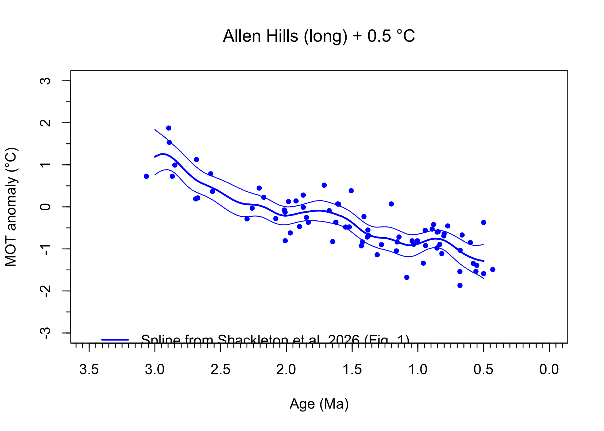
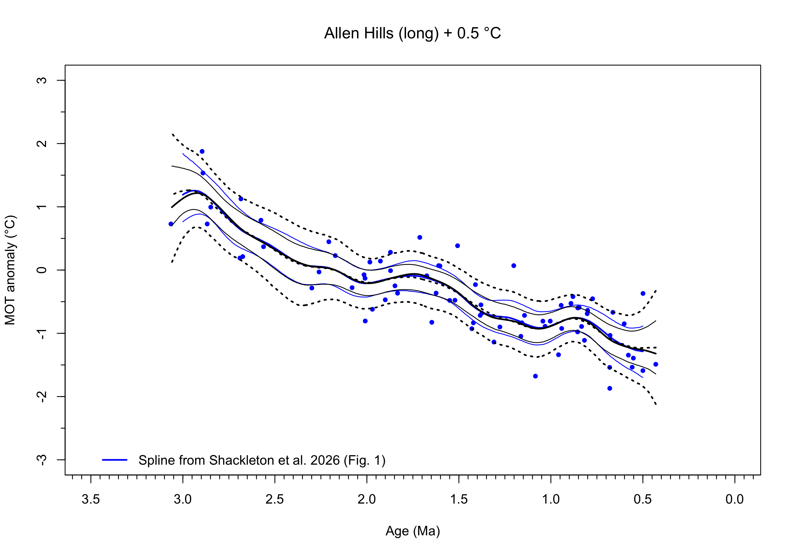
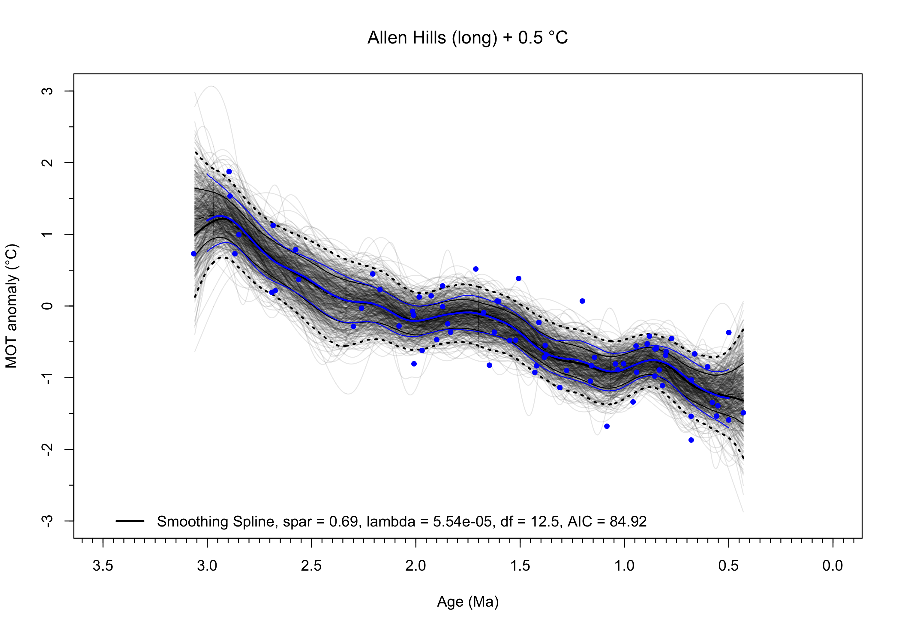

## Introduction

Here we show the R code that we used to reproduce Matlab `csaps()`
smoothing spline fit to the Allen Hills “long shapshot” in Shackleton et
al. (2026), and to fit an alternative optimized smoothing spline in R. A
smoothing splines is a cubic spline $`f\left(x_{i}\right)`$ that is fit
to some data $`y_{i}`$ by minimizing a “penalized” residual
sum-of-squares

``` math
RSS\left(f,\lambda \right)=\{\textsf{goodness of fit}\}+\lambda\{\textsf{roughness}\}
```

The first term represents the goodness-of-fit of the spline curve to the
data, while the second “penalty” term describes the rigidity or local
variability of the curve. If λ = 0, the fitted spline simply
interpolates between the $`y_{i}`$’s, while as λ → ∞ the penalty term
increases and the optimal fitted curve becomes a least-squares straight
line (Hastie and Tibshirani, 1990, p. 27).

The objective function used by the Matlab `csaps()` function is
``` math
RSS\left(f,\mathrm{\lambda }\right)=\left\{\ p\sum_{i=1}^{n} {w_{i}{\left(y_{i}-f\left(x_{i}\right)\right)}^{2}}+\left(1-p\right)\int {\left[f^{\prime \prime }\left(x\right)\right]}^{2}\,dx\right\}
```

Where $`f^{\prime \prime }\left(x\right)`$ is the second derivative of
the spline curve, and the $`w_{i}`$’s are possible weights for each data
value, $`p`$ is the user-selected smoothing parameter, and
$`p=1/\left(1+\mathrm{\lambda }\right)`$. When $`p=0`$, a straight-line
fit is obtained (i.e. as $`λ→∞`$, $`p→0`$), while if $`λ=0`$, then
$`p=1`$ and the spline $`(f\left(x_{i}\right))`$ simply interpolates
between points.

The objective function for the R `smooth.spline()` function is
``` math
RSS\left(f,\lambda \right)=\sum_{i=1}^{n} {w_{i}{\left(y_{i}-f\left(x_{i}\right)\right)}^{2}}+\lambda \int {{\left[f^{\prime \prime }\left(x\right)\right]}^{2}dx,}
```

Again, If $`λ=0`$, the fitted spline simply interpolates between the
$`y_{i}`$’s, while as $`λ→∞`$ the penalty term increases and the optimal
fitted curve becomes a least-squares straight line. The smoothing
parameter is thus a measure of the “wiggliness” of the curve and can be
set by a user at some fixed, scientifically based value, or it can be
estimated by Generalized Cross Validation (GCV, Wahba, 1990, sec. 4.3)
or some other approach. (GCV is a computationally efficient
“leave-one-out” approach that is used to find an optimum trade-off
between the goodness-of-fit and wigglyness of smoothing spline: an
extremely smooth spline won’t fit the data very well, while an extremely
wiggly spline can fit the data perfectly at the expense of being
extremely non-smooth.) We use this approach below to obtain and
“optimal” smoothing spline.

In the case of the R function, there are three ways of specifying or
describing the amount of smoothing: via $`λ`$; via a *spar* value, a
scaleless description of the amount of smoothing which generally varies
between 0 an 1; and via the equivalent degrees of freedom, $`df`$
(Hastie and Tibshirani, 1990, sec. 3.5), a general measure of the amount
of fitting done by the spline. Low values of $`df`$ describe a fitted
curve with fewer inflections while higher values describe a more wiggly
curve.

Because the internal algorithms in the R and Matlab functions differ,
there is no direct conversion between the methods (i.e. selecting the
same value of $`λ`$ for both will not yield equivalent results). The R
function can nevertheless be used to approximate the results of applying
the Matlab function by iteratively varying the *spar* parameter, and
minimizing the sum-of-squared differences between the R- and
Matlab-fitted smoothing splines. We use this approach below to
approximate the results of from the Matlab `csaps()` using the R
`smooth.spline()` functio

## Read data

Load the neccessary packages. `{readxl}` and `{writexl}` read and write
Excel files, `{Hmisc}` adds supplemental tick marks and plots, and
`{matrixStats}` is used to get the bootstrap confidence itervals.

``` r
library(readxl, writexl)
library(Hmisc)
library(matrixStats)
```

Read the Allen Hills “long” snapshot data, and add 0.5 °C to account for
the bias in the MOT anomalies.

``` r
# Allen_Hills_long data
# columns Q, X, Y and Z from the "Data Summary" tab of 
# AllanHills_XeKr_temp-recon_2026-pubData-2.xlsx
data_path <- "~/Projects/globalT/MOT_Splines/data/"
file_name <- "AH_long.xlsx" 
xlxs_file <- paste(data_path, file_name, sep = "")
AH_long <- read_excel(xlxs_file)
head(AH_long); tail(AH_long)
```

    ## # A tibble: 6 × 9
    ##   Age_ka AgeMa Rel_err_Myr Abs_err_Myr MOT_anomaly MOT_rel_err MOT_abs_err Snapshot seqnum
    ##    <dbl> <dbl>       <dbl>       <dbl>       <dbl>       <dbl>       <dbl> <chr>     <dbl>
    ## 1   430  0.43       0.0909      0.102       -1.99        0.559       0.750 'long'      128
    ## 2   499. 0.499      0.104       0.118       -0.870       0.431       0.660 'long'       89
    ## 3   500  0.5        0.0909      0.106       -2.09        0.574       0.761 'long'      129
    ## 4   552. 0.552      0.0618      0.0866      -1.89        0.526       0.726 'long'       44
    ## 5   558. 0.558      0.0618      0.0871      -2.04        0.547       0.741 'long'       56
    ## 6   579. 0.579      0.0618      0.0888      -1.85        0.519       0.721 'long'       45

    ## # A tibble: 6 × 9
    ##   Age_ka AgeMa Rel_err_Myr Abs_err_Myr MOT_anomaly MOT_rel_err MOT_abs_err Snapshot seqnum
    ##    <dbl> <dbl>       <dbl>       <dbl>       <dbl>       <dbl>       <dbl> <chr>     <dbl>
    ## 1  2690   2.69      0.0909       0.310      -0.31        0.313       0.590 'long'      140
    ## 2  2848.  2.85      0.0532       0.318       0.495       0.268       0.567 'long'       81
    ## 3  2868.  2.87      0.0593       0.321       0.229       0.247       0.558 'long'       49
    ## 4  2891.  2.89      0.0593       0.323       1.03        0.319       0.593 'long'       83
    ## 5  2895.  2.90      0.0593       0.324       1.38        0.367       0.620 'long'       84
    ## 6  3065.  3.06      0.0618       0.343       0.229       0.275       0.570 'long'       82

``` r
# MOT_anomaly + 0.5C
AH_long$MOT_anomaly <- AH_long$MOT_anomaly + 0.5
```

Read Shackleton et al.’s fitted spline, and add 0.5 °C.

``` r
# spline from paper
# columns A-D from the "Splined Records" tab of AllanHills_XeKr_temp-recon_2026-pubData-2.xlsx
file_name <- "AH_long_spline_paper.xlsx" 
xlxs_file <- paste(data_path, file_name, sep = "")
AH_long_spline_paper <- read_excel(xlxs_file)
head(AH_long_spline_paper); tail(AH_long_spline_paper)
```

    ## # A tibble: 6 × 5
    ##   Age_ka AgeMa MOT_anomaly MOT_lower MOT_upper
    ##    <dbl> <dbl>       <dbl>     <dbl>     <dbl>
    ## 1    500 0.5         -1.79     -2.20     -1.39
    ## 2    505 0.505       -1.78     -2.19     -1.39
    ## 3    510 0.51        -1.78     -2.18     -1.40
    ## 4    515 0.515       -1.78     -2.17     -1.40
    ## 5    520 0.52        -1.78     -2.16     -1.41
    ## 6    525 0.525       -1.77     -2.15     -1.41

    ## # A tibble: 6 × 5
    ##   Age_ka AgeMa MOT_anomaly MOT_lower MOT_upper
    ##    <dbl> <dbl>       <dbl>     <dbl>     <dbl>
    ## 1   2975  2.98       0.730     0.316      1.28
    ## 2   2980  2.98       0.721     0.306      1.29
    ## 3   2985  2.98       0.717     0.297      1.30
    ## 4   2990  2.99       0.710     0.286      1.31
    ## 5   2995  3.00       0.701     0.276      1.32
    ## 6   3000  3          0.691     0.263      1.34

``` r
# MOT + 0.5C
AH_long_spline_paper$MOT_anomaly <- AH_long_spline_paper$MOT_anomaly + 0.5
AH_long_spline_paper$MOT_lower <- AH_long_spline_paper$MOT_lower + 0.5
AH_long_spline_paper$MOT_upper <- AH_long_spline_paper$MOT_upper + 0.5
```

Plot the data, and the spline from the paper.

``` r
# Plot the data and spline from the paper
# data
plot(AH_long$MOT_anomaly ~ AH_long$AgeMa, type = "p", pch = 16, cex = 0.8, col = "blue",
     xlim = c(3.5, 0), ylim = c(-3.0, 3.0), xlab = "Age (Ma)", ylab = "MOT anomaly (°C)", 
     font.main = 1, main = "Allen Hills (long) + 0.5 °C")
minor.tick(nx = 10, tick.ratio = 0.5)

# add spline from paper
lines(AH_long_spline_paper$AgeMa, AH_long_spline_paper$MOT_anomaly, lwd=2, col="blue")
lines(AH_long_spline_paper$AgeMa, AH_long_spline_paper$MOT_lower, lwd=1, col="blue")
lines(AH_long_spline_paper$AgeMa, AH_long_spline_paper$MOT_upper, lwd=1, col="blue")
leg_label <- paste("Spline from Shackleton et al. 2026 (Fig. 1)", sep="")
legend(3.5, -2.75, legend=c(leg_label), col="blue", lwd=2, bty="n")
```

<!-- -->

``` r
#dev.print(pdf, "AH_long_Shackleton_spline.pdf")
```

## Set-up tasks

Set target points for fitted splines:

``` r
# target pts for fitted spline
nsamp <- length(unique(AH_long$AgeMa))
age_max <- max(AH_long$AgeMa)
age_min <- min(AH_long$AgeMa)
x_targ <- seq(age_min, age_max, by = 0.005)
head(x_targ); tail(x_targ)
```

    ## [1] 0.430 0.435 0.440 0.445 0.450 0.455

    ## [1] 3.035 3.040 3.045 3.050 3.055 3.060

``` r
nfits <- length(x_targ)
nfits
```

    ## [1] 527

Set weights. `weights` weigh each observation by its uncertainty. `ones`
weigh each observation equally

``` r
# weights
weights <- 1/(AH_long$MOT_abs_err^2)
ones = rep(1, length(AH_long$AgeMa))
```

Set parameters for bootstrap estimates of uncertainty

``` r
# bootstrap estimates of fitted values
set.seed(1234)
nreps <- 10000
```

Three curves will be fit here: 1) the approximation of the Shackleton et
al. spline, 2) a GCV-optimized spine, and 3) and OLS linear fit. Define
arrays and vectors to hold results:

``` r
ncurves <- 3

# arrays and vectors
fits <- matrix(0, nrow = nsamp, ncol = ncurves)
residuals <- matrix(0, nrow = nsamp, ncol = ncurves)
fits_bootstrap <- matrix(0, nrow=nfits, ncol = nreps)
df <- as.numeric(rep(0, ncurves))
lambda <- as.numeric(rep(0, ncurves))
rss <- as.numeric(rep(0, ncurves))
tss <- as.numeric(rep(0, ncurves))
sigma2 <- as.numeric(rep(0, ncurves))
AIC <- as.numeric(rep(0, ncurves))
rsq <- as.numeric(rep(0, ncurves))
adj_rsq <- as.numeric(rep(0, ncurves))
F <- as.numeric(rep(0, ncurves))

model_colors <- c("black", "purple", "red")
```

## Reproduce the Matlab smoothing spline with the R smoothing spline

The R `smooth.spline()` equivalent of the Matlab `csaps()` spline in
Shackleton et al. can be estimated by repeated fitting splines with
different values of the *span* parameter, ranging from 0.0 to 2.0 by
0.1:

``` r
# brute-force optinmization of spar value
npts <- 201
spar_opt <- as.numeric(seq(0.0, 2.0, by = 0.01))
df_opt <- as.numeric(rep(0, npts))
lambda_opt <- as.numeric(rep(0, npts))
rss_opt <- as.numeric(rep(0, npts))
tss_opt <- as.numeric(rep(0, npts))
rsq_opt <- as.numeric(rep(0, npts))

for (k in 1:npts) {
  curve_01 <- smooth.spline(AH_long$AgeMa, AH_long$MOT_anomaly, w = ones, 
                  spar = spar_opt[k])
  df_opt[k] <- curve_01$df; lambda_opt[k] <- curve_01$lambda
  
  y_pred <- predict(curve_01, AH_long_spline_paper$AgeMa, deriv = 0)$y
  resid <- y_pred - (AH_long_spline_paper$MOT_anomaly)
  rss_opt[k] <- sum(resid^2 )
  tss_opt[k] <- sum((AH_long_spline_paper$MOT_anomaly - 
      mean(AH_long_spline_paper$MOT_anomaly))^2)
  rsq_opt[k] <- 1.0 - (rss_opt[k]/tss_opt[k])
}
```

Which value of *spar* produces the best fit?

``` r
match_paper <- data.frame(spar_opt, df_opt, lambda_opt, rss_opt, tss_opt, rsq_opt)
k_opt <- which.max(rsq_opt)
print(k_opt)
```

    ## [1] 70

``` r
print(match_paper[k_opt, ])
```

    ##    spar_opt  df_opt   lambda_opt   rss_opt  tss_opt  rsq_opt
    ## 70     0.69 12.4969 5.544198e-05 0.2163786 219.8993 0.999016

A *spar* value of 0.69 produces the best fit to published spline.

Refit the approximated spline and calculate the bootstrap confidence
limits (while suppressing the individual fitted splines).

``` r
# Shackleton et al. spline

spar <- 0.69
curve_01 <- smooth.spline(AH_long$AgeMa, AH_long$MOT_anomaly, w = ones, 
    spar = spar, keep.stuff = TRUE) # Shackleton et al. specs. for lambda
y_pred_curve_01 <- predict(curve_01, x_targ, deriv = 0)$y
y_d1_curve_01 <- predict(curve_01, x_targ, deriv = 1)$y
y_d2_curve_01 <- predict(curve_01, x_targ, deriv = 2)$y
df[1] <- curve_01$df; lambda[1] <- curve_01$lambda; fits[, 1] <- curve_01$y
residuals[, 1] <- AH_long$MOT_anomaly - curve_01$y
sigma2[1] <- sum(residuals[, 1]^2)/(nsamp - 1.0)
rss[1] <- sum(residuals[, 1]^2 )
tss[1] <- sum((AH_long$MOT_anomaly - mean(AH_long$MOT_anomaly))^2)
# http://users.stat.umn.edu/~helwig/notes/smooth-spline-notes.html#aic-and-bic
max_log_lik <- (-1.0 / (2.0 * sigma2[1])) * rss[1] - 
  1.0 * (nsamp / 2.0) * log(sigma2[1]) -  1.0 * (nsamp / 2.0) * log(2 * pi)
AIC[1] <- - 2.0 * max_log_lik + 2.0 * df[1]
AIC[1] <- round(AIC[1], 2)
print(AIC[1])
```

    ## [1] 84.92

``` r
# R-sq values
rsq[1] <- 1 - (rss[1]/tss[1])
adj_rsq[1] <- 1 - (rss[1] / (nsamp - df[1])) / (tss[1] / (nsamp - 1))
rsq[1] <- round(rsq[1], digits = 3)
adj_rsq[1] <- round(adj_rsq[1], digits = 3)
rsq[1]; adj_rsq[1]
```

    ## [1] 0.759

    ## [1] 0.715

``` r
# bootsrap CL's -- calculate but do not plot
fits_bootstrap <- matrix(0, nrow=nfits, ncol = nreps)
k <- 0; j <- 1
for (i in 1:nreps) {
  # print(i)
  x_boot <- AH_long$AgeMa + rnorm(nsamp, mean = 0, sd = AH_long$Rel_err_Myr)
  x_boot <- x_boot[order(x_boot)]
  y_boot <- AH_long$MOT_anomaly + rnorm(nsamp, mean = 0, sd = AH_long$MOT_abs_err)
  y_boot <- y_boot[order(x_boot)]
  # points(x_boot, y_boot, pch = 16, cex = 0.5, col = "red")
  
  fit_boot <- smooth.spline(x_boot, y_boot, w = ones, spar = spar ) # df = df[1])
  if (length(x_boot) == length(fit_boot$y)) {
    y_pred <- predict(fit_boot, x_targ, deriv = 0)$y
    # if (i < 500) {
    #   lines(x_targ, y_pred, col=adjustcolor(model_colors[j], alpha = 0.05))
    #   # points(AH_long$AgeMa, y_pred, pch = 16, cex = 0.5, col = "red")
    # }
    k <- k + 1
    fits_bootstrap[1:nfits, k] <- y_pred[1:nfits]
  }
}

# get the various quantiles of the fitted splines
boot_cl_01 <- rowQuantiles(fits_bootstrap, probs = c(0.025, 0.16, 0.50, 0.84, 0.975))
head(boot_cl_01)
```

    ##           2.5%       16%       50%        84%      97.5%
    ## [1,] -2.118189 -1.644276 -1.225705 -0.8016999 -0.3295480
    ## [2,] -2.091171 -1.632063 -1.226045 -0.8133095 -0.3487568
    ## [3,] -2.064248 -1.623237 -1.226660 -0.8246394 -0.3747414
    ## [4,] -2.036599 -1.613022 -1.227134 -0.8337606 -0.3990829
    ## [5,] -2.015464 -1.602782 -1.225915 -0.8426400 -0.4202588
    ## [6,] -1.992610 -1.593298 -1.227111 -0.8539710 -0.4441156

``` r
plot(AH_long$MOT_anomaly ~ AH_long$AgeMa, type = "p", pch = 16, cex = 0.8, col = "blue",
     xlim = c(3.5, 0), ylim = c(-3.0, 3.0), xlab = "Age (Ma)", ylab = "MOT anomaly (°C)", 
     font.main = 1, main = "Allen Hills (long) + 0.5 °C")
minor.tick(nx = 10, tick.ratio = 0.5)

# add spline from paper
lines(AH_long_spline_paper$AgeMa, AH_long_spline_paper$MOT_anomaly, lwd=2, col="blue")
lines(AH_long_spline_paper$AgeMa, AH_long_spline_paper$MOT_lower, lwd=1, col="blue")
lines(AH_long_spline_paper$AgeMa, AH_long_spline_paper$MOT_upper, lwd=1, col="blue")
leg_label <- paste("Spline from Shackleton et al. 2026 (Fig. 1)", sep="")
legend(3.5, -2.75, legend=c(leg_label), col="blue", lwd=2, bty="n")

# add now add the bootstrap CL's to plot
lines(x_targ, boot_cl_01[, 2], col = model_colors[1])
lines(x_targ, boot_cl_01[, 4], col = model_colors[1])
lines(x_targ, boot_cl_01[, 1], lty = "dotted", lwd = 2, col = model_colors[1])
lines(x_targ, boot_cl_01[, 5], lty = "dotted", lwd = 2, col = model_colors[1])
lines(x_targ, boot_cl_01[, 3], lty = "dotted", lwd = 2, col = model_colors[1])
lines(x_targ, y_pred_curve_01, lwd=2, col=model_colors[1])
```

<!-- -->

``` r
#dev.print(pdf, "AH_long_Shackleton_spline.pdf")
```

The blue solid line in the figure (mostly hidden, except at the ends) is
the fitted spline from Shackleton et al. while the the thick black solid
line is the approximated spline form `spline.smooth()`. The thin black
lines are the median and 16th and 84th percentiles (plus or minus one
standard error) of the 10,000 bootstrap replications, while the black
dashed lines are the 2.5th and 97.5th percentiles (plus or minus two
standard errors). The standard errors from the Shackleton et al.’s
spline do not match the ones here because the bootstramp samples are not
identical.

Now replot the approximated Shackleton et al. spline including the
fitted splines for the first 500 bootstrap replications (a sufficient
number for examiing the nature of the replications).

``` r
# replot with first 500 replicates shown

plot(AH_long$MOT_anomaly ~ AH_long$AgeMa, type = "p", pch = 16, cex = 0.8, col = "blue",
     xlim = c(3.5, 0), ylim = c(-3.0, 3.0), xlab = "Age (Ma)", ylab = "MOT anomaly (°C)", 
     font.main = 1, main = "Allen Hills (long) + 0.5 °C")
minor.tick(nx = 10, tick.ratio = 0.5)

# bootstrap estimates of fitted values
set.seed(1234)
# bootsrap CL's
fits_bootstrap <- matrix(0, nrow=nfits, ncol = nreps)
k <- 0; j <- 1
for (i in 1:nreps) {
  # print(i)
  x_boot <- AH_long$AgeMa + rnorm(nsamp, mean = 0, sd = AH_long$Rel_err_Myr)
  x_boot <- x_boot[order(x_boot)]
  y_boot <- AH_long$MOT_anomaly + rnorm(nsamp, mean = 0, sd = AH_long$MOT_abs_err)
  y_boot <- y_boot[order(x_boot)]
  # points(x_boot, y_boot, pch = 16, cex = 0.5, col = "red")
  
  fit_boot <- smooth.spline(x_boot, y_boot, w = ones, spar = spar ) # df = df[1])
  if (length(x_boot) == length(fit_boot$y)) {
    y_pred <- predict(fit_boot, x_targ, deriv = 0)$y
    if (i < 500) {
      lines(x_targ, y_pred, col=adjustcolor(model_colors[j], alpha = 0.1))
      # points(AH_long$AgeMa, y_pred, pch = 16, cex = 0.5, col = "red")
    }
    k <- k + 1
    fits_bootstrap[1:nfits, k] <- y_pred[1:nfits]
  }
}

lines(x_targ, boot_cl_01[, 2], col = model_colors[1])
lines(x_targ, boot_cl_01[, 4], col = model_colors[1])
lines(x_targ, boot_cl_01[, 1], lty = "dotted", lwd = 2, col = model_colors[1])
lines(x_targ, boot_cl_01[, 5], lty = "dotted", lwd = 2, col = model_colors[1])
lines(x_targ, boot_cl_01[, 3], lty = "dashed", col = model_colors[1])
lines(x_targ, y_pred_curve_01, lwd=2, col=model_colors[1])

lines(AH_long_spline_paper$AgeMa, AH_long_spline_paper$MOT_anomaly, lwd=2, col="blue")
lines(AH_long_spline_paper$AgeMa, AH_long_spline_paper$MOT_lower, lwd=1, col="blue")
lines(AH_long_spline_paper$AgeMa, AH_long_spline_paper$MOT_upper, lwd=1, col="blue")
leg_label <- paste("Smoothing Spline, spar = ", as.character(round(spar, 3)), 
    ", lambda = ", as.character(round(lambda[1],7)), 
    ", df = ", as.character(round(df[1], 2)), 
    ", AIC = ", as.character(round(AIC[1], 2)), sep="")
legend(3.5, -2.75, legend=c(leg_label), col=c(model_colors[1]), lwd=2, bty="n")

points(AH_long$MOT_anomaly ~ AH_long$AgeMa, pch = 16, cex = 0.8, col = "blue")
```

<!-- -->

``` r
#dev.print(pdf, "AH_long_spline_comparison.pdf")
```
